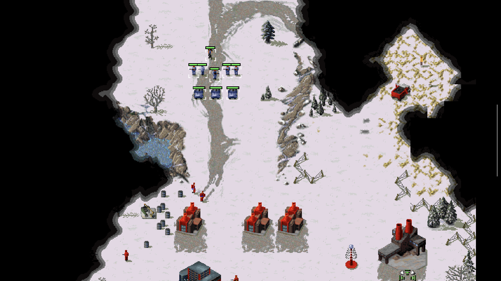
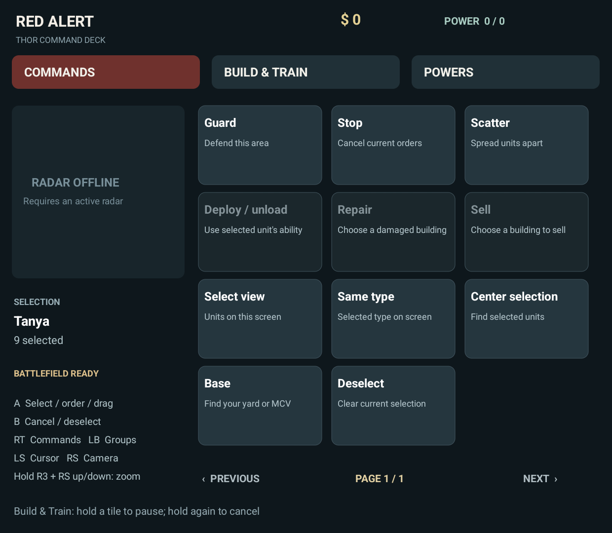
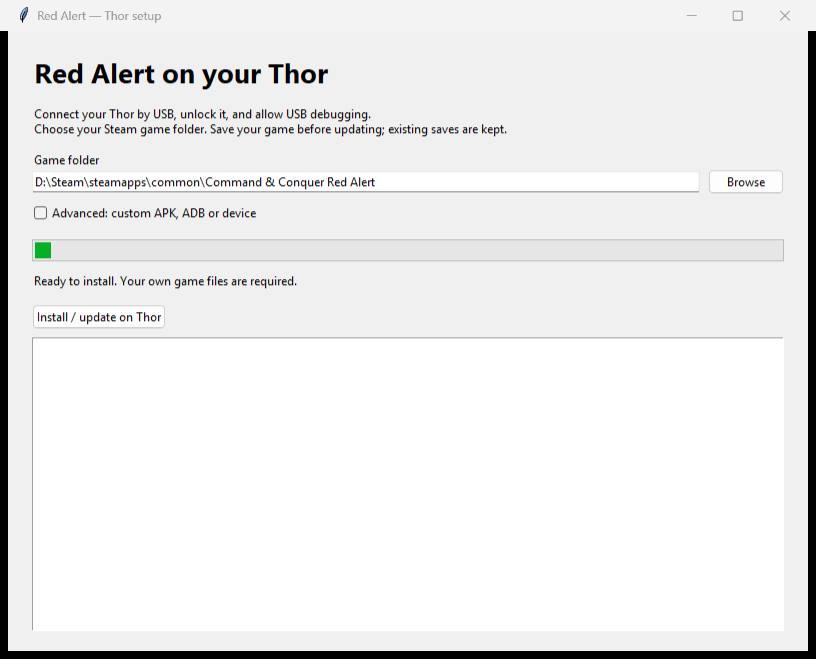

# Red Alert on the AYN Thor

I wanted the original Red Alert on my Thor, campaigns and all. This runs it with controller support and a command deck on the bottom screen. Counterstrike, Aftermath and the Ant missions are here too.

This uses the original game engine through Vanilla Conquer's Android branch. Bring your own game files. The APK and installer contain no retail game data.

**Development preview 0.1.0-dev.4.** Tested on a Thor: both original campaign starts, Counterstrike, Aftermath, Ant missions, campaign save/load, building placement, infantry production, groups and returning from Home. Every campaign mission has not been played through. See [verification and remaining limits](docs/Verification.md).

This build is for campaigns and offline skirmish. Multiplayer is not included.

| Top screen | Bottom screen |
|---|---|
|  |  |

## Downloads

[Download the development preview](https://github.com/ROM-HackZ/red-alert-AYN-thor/releases/tag/v0.1.0-dev.4).

| File | What it is |
|---|---|
| `RedAlert-Thor-Setup.exe` | Windows installer. Includes the app and USB tools. No Python required. |
| `RedAlert-Thor.apk` | Android app, if you are installing manually or updating an existing setup. Game data is still required. |
| `RedAlert-Thor-Source.zip` | Complete modified source and setup scripts for building or installing from macOS/Linux. |
| `SHA256SUMS.txt` | Checksums for the downloads. |

## Install

| Computer | Setup |
|---|---|
| Windows | Run `RedAlert-Thor-Setup.exe`, choose your Steam Red Alert folder, then click **Install / update on Thor**. The packaged installer includes the APK and ADB. |
| macOS / Linux | Run `python3 scripts/install-thor.py` for the same UI. Requires Python with Tkinter, Android SDK Platform Tools and the built APK. A terminal option is below. |

Connect the Thor by USB, unlock it and allow USB debugging. Save your game before updating. Setup verifies each copy and reuses files that already match. App updates keep your saves.

Once installed, open **Red Alert - Thor** and play. It runs on its own after a reboot. No root, Shizuku or activation step.

ADB and APK paths are under **Advanced** if you need them. If setup cannot find the Thor, check that the cable carries data and accept the USB debugging prompt on the handheld.

<details>
<summary>Windows setup window</summary>



</details>

Choose your Steam `Command & Conquer Red Alert` folder. Setup imports the base game, both expansions, all four disc archives, and the campaign map video and trailers when present. Windows executables, DLLs and PC settings stay on your computer.

```sh
python3 scripts/install-thor.py --game "/path/to/Command & Conquer Red Alert" --adb "/path/to/adb" --apk artifacts/RedAlert-Thor.apk
```

## Controls

| Control | Action |
|---|---|
| Left stick | Move the cursor. It stays where you leave it. Works in menus too. |
| Right stick | Pan the map. |
| Hold R3 + right stick up / down | Zoom in / out. Up zooms in. |
| A | Select, issue an order, or confirm a building placement. Hold A and move the left stick to drag a selection box. |
| B | Cancel targeting or placement, keeping your selection. Otherwise deselect or go back. |
| X | Guard area. |
| Y | Stop. |
| Hold LT | Add units to the selection. |
| Hold RT | Command wheel. Choose with the **left stick**, press A to use it. Release RT or press B to close without choosing. |
| Hold LB | Group wheel. Left stick chooses; A recalls, X replaces, LT + X adds, Y centres. D-pad left/right switches groups 1–8 / 9–10. Release LB or press B to close. |
| L3 | Center the camera on the selection. |
| LT + L3 | Select the same unit type on screen. |
| RB | Toggle minimap navigation. Left stick moves the marker; A jumps there; B closes it. Requires working radar. |
| D-pad up / down | Choose a command-deck button. In menus, jump between the game's buttons. |
| D-pad left / right | Change command-deck pages. |
| Hold LT + D-pad | Jump between the game's own buttons. |
| Select | Switch between Commands, Build & Train and Powers. |
| Start | Open the game menu. |

L3 and R3 mean clicking the left and right sticks. You do not need to hold a stick button to use the cursor. Camera panning and controller zoom pause while A is held so your selection box stays anchored.

Health bars appear on selected units and damaged units, including visible enemies. They follow the original visibility rules.

Original Red Alert had no camera zoom. This build adds it; it does not rotate the camera.

Groups follow the original RA1 rule: each unit belongs to one group. Assigning it to another group moves it out of the previous one.

| Touch gesture | Action |
|---|---|
| Tap | Select or issue an order. |
| One-finger drag | Selection rectangle. |
| Two-finger drag | Pan the map. |
| Pinch | Zoom. |
| Two-finger tap | Deselect. |
| Tap or drag on the bottom-screen minimap | Jump or pan across those map positions. |

## Building, training and powers

**Build & Train** follows the original sidebar. Choices stay available while you have the required buildings; you do not have to keep a production building selected.

| Action | What happens |
|---|---|
| Tap a build tile | Start production, resume a paused job, or use a completed item. |
| Hold a tile during production | Pause it. Hold again to cancel and refund it. |
| Choose a ready building | Enter placement mode. Move to a valid spot and press A. |
| B during placement | Leave placement mode. The completed building is still ready to use. |
| Deploy / unload | Use the selected unit's native ability. MCVs need clear space. Packing a yard is available only when the original rules allow it. |

RA1 has fixed camera and building orientations. Its production limits and technology requirements still apply. **Powers** shows the actual Red Alert powers available to your faction and mission.

The deck reads the engine's selection, build lists, production progress, artwork and radar directly. It does not detect buttons from screenshots. Radar respects the original shroud and availability rules.

The main menu has the original campaign and expansion choices. The bottom screen also has an **Ant missions** button. Saves without a typed description get a default name, so you can save using the controller.

## Files and saves

| Location on the Thor | Contents |
|---|---|
| `Android/data/org.redalertthor.app/files/game/` | Imported retail data. |
| `Android/data/org.redalertthor.app/files/user/vanillara/` | Thor settings and saves. |
| `Android/data/org.redalertthor.app/files/import-manifest.json` | Sizes and SHA-256 hashes of imported files. |

Use saves made by the Thor build. Setup does not copy or change your PC saves. Before uninstalling, save your mission, press **Start**, then tap **Export saves** on the bottom screen. Choose Downloads, a USB drive or another storage provider. The ZIP contains your Thor saves and settings. Android removes the app's own data when you uninstall it.

To restore an exported backup after reinstalling, extract its `vanillara` folder, then copy it into the app's `files/user/` folder with ADB while the game is closed. Keep a copy of your backup until you have loaded the save successfully.

Campaigns support save/load. The original skirmish menu disables saving. Save a campaign before leaving it for a long time; Android can close background apps when it needs memory.

If sound is silent, check Android's media volume and the AYN game profile. The test Thor's game assistant had media volume set to zero.

## Build

Dependencies are pinned in [THOR-UPSTREAM.json](THOR-UPSTREAM.json). You need JDK 17, Python 3.12+, CMake, Ninja, Android SDK 36, build-tools 36.0.0, NDK 27.2.12479018, and Gradle 8.11.1. Set `ANDROID_HOME` and `JAVA_HOME` for your machine.

```sh
python scripts/build-thor.py
python -m unittest discover -s scripts/tests -v
python scripts/check-source.py
```

Windows builds use WSL Ubuntu and stage source under `~/.cache/redalert-thor/build` to avoid slow builds through OneDrive. Linux builds run the shell script directly. On macOS, set `JAVA_HOME` to your JDK 17 installation and install the same SDK/NDK and build tools. Put Gradle on PATH or set `THOR_GRADLE` to its executable. The APK is written to `artifacts/RedAlert-Thor.apk`.

To package a desktop installer on its target OS, install PyInstaller 6.16.0 and run:

```sh
python scripts/package-installer.py --adb-dir "/path/to/platform-tools"
```

The default build is a debug APK for development. Public downloads use a signed release build without the QA receiver. To build your own release, set `THOR_BUILD_TYPE=release`, `THOR_SIGNING_STORE`, `THOR_SIGNING_ALIAS`, `THOR_SIGNING_PASSWORD` and `THOR_KEY_PASSWORD`. Keep your key outside Git and reuse it for your updates. On Windows, pass these variables into WSL with `WSLENV`, or run the shell build inside WSL.

ADB input probes and the QA receiver are development tools. Test scripts live in `scripts/qa/`; temporary results belong in `artifacts/`. GitHub checks the installer on Windows, macOS and Linux and builds an Android debug APK. Gameplay still needs a real Thor test.

## Bugs

[Open an issue](https://github.com/ROM-HackZ/red-alert-AYN-thor/issues) with the app version, mission and what you pressed. A screenshot helps. Do not upload the retail game archives.

## Upstream

Engine base: [sandstranger/Vanilla-Conquer](https://github.com/sandstranger/Vanilla-Conquer), revision `00733633a026aac4a02e5ccf29a4f14db80441a1`. That Android work is also used by Classic Core. Earlier engine work comes from the Vanilla Conquer contributors and EA's source release.

Updates are deliberate: review the engine changes, update the pin, merge, then rerun campaign, expansion, production, input and lifecycle tests. A new upstream commit does not silently replace the engine in an installed app.

The engine is GPLv3 with EA's additional terms; see [License.txt](License.txt). SDL2 and OpenAL Soft notices are included in the APK. The original upstream README is preserved in [docs/Vanilla-Conquer.md](docs/Vanilla-Conquer.md).
